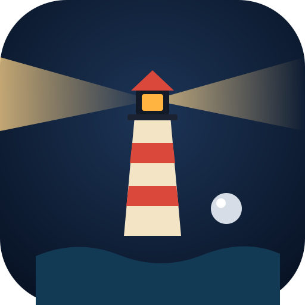
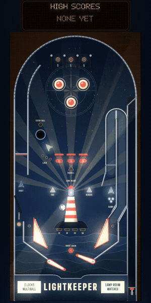
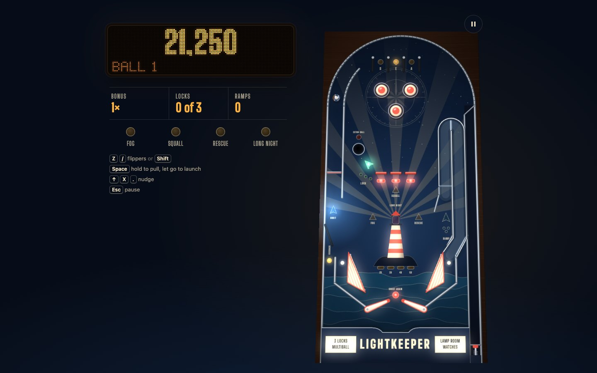

<p align="center">
  
</p>

<h1 align="center">Lightkeeper</h1>

<p align="center">
  A pinball table for the browser: a lighthouse on a night sea, built from scratch in TypeScript and WebGL&nbsp;2.
</p>

<p align="center">
  <a href="https://github.com/AshwinSathian/lightkeeper/actions/workflows/ci.yml"></a>
  <a href="LICENSE"></a>
  
  
</p>

<p align="center">
  <a href="https://lightkeeper.ashwinsathian.com"><b>Play it at lightkeeper.ashwinsathian.com</b></a>
</p>

<p align="center">
  
  &nbsp;
  
</p>

## Features

**The table**
- Skill shot: plunge so the ball drops through the flashing lane.
- S, E and A lanes raise the end-of-ball bonus up to 5×. The flippers move the lit lanes.
- Three pop bumpers, two slingshots, a spinner on the left orbit, and a ramp that feeds the right flipper.
- Three drop targets light the lock. Lock three balls in the lamp room for multiball, where every ramp and orbit is a jackpot and three jackpots light a super jackpot.
- Three timed watches: Fog (spinner), Squall (bumpers) and Rescue (follow the lit shot). Finish two for an extra ball and all three for Long Night, where every shot scores 50,000.
- Kickback in the left outlane, ball save after each launch, combos, nudging and tilt.

**The game around it**
- Three modes: 3 balls, 3 minutes (unlimited balls against the clock) and Practice (every drain saved).
- A 128×32 amber dot-matrix display for scores, mode countdowns and callouts.
- Top-five high scores per mode with three-letter initials, kept on the device.
- Every game can be watched again at 1×, 2× or 4×, or shared as a link.
- Layouts made for phone, tablet and desktop. Wide screens get a tilted cabinet view.
- Installs as an app and plays offline after the first visit.

## Controls

| | Touch | Keyboard | Gamepad |
|---|---|---|---|
| Left flipper | Left half of the screen | Z, Left Shift, ← | LB / LT |
| Right flipper | Right half | /, Right Shift, → | RB / RT |
| Plunger | Hold the right half, let go | Hold Space, Enter or ↓ | A |
| Nudge | Flick upward | ↑, X, . | Y, X, B |
| Pause | Pause button | Esc or P | Start |

## How it's built

TypeScript and Vite with no runtime dependencies. The build inlines everything into one 35 KB (gzipped) HTML file; the only other request is a 20 KB subset of Big Shoulders Display.

**One table description.** `src/table.ts` lists every wall, post, bumper, sensor and lamp. Physics, the painter and the rules all read it, so moving a bumper is one edit.

**Deterministic physics at 480 Hz.** `src/physics.ts` steps a fixed 1/480 s and uses only `+ - * /` and `Math.sqrt`, which IEEE 754 makes identical on every engine. Sine and cosine come from a Taylor series in `src/math.ts` because `Math.sin` is allowed to differ between browsers. Randomness is a seeded mulberry32. A game is fully described by its seed and its inputs, and that is what a replay link is: varint-packed input ticks in a URL fragment (`src/replay.ts`). A ball moves at most 8.75 units per step against a 15-unit radius, so it can't pass through a wall.

**Flippers.** Each flipper is a tapered capsule driven by angular acceleration with a speed cap. A contact uses the flipper's surface velocity at the contact point, and rubber bounces less at higher impact speeds (`e = e0 / (1 + k·v)`, the falloff model Visual Pinball uses). Hit the ball near the tip and it crosses the table; near the base, it goes up the middle.

**The ramp is a second collision layer.** Crossing the ramp mouth going up moves the ball to layer 1, where only the ramp's walls exist. It drops back to layer 0 at the exit, or if it rolls back down.

**Inputs land on the tick they happened.** Events keep their `timeStamp`, and each frame applies them at the matching tick inside the frame's span, so flipper timing isn't rounded to the 16 ms frame.

**Rendering with no image files.** `src/bake.ts` paints the playfield, the layer above the ball and a sprite atlas with Canvas 2D at the screen's resolution. `src/gl.ts` composites them in WebGL 2. Lamps fade like incandescent bulbs, faster on than off. The ball is shaded as a chrome sphere that samples the lit playfield around it, so it reflects the lamps as they change. Bloom runs at quarter resolution and switches itself off if frames run long. The cabinet view draws the finished frame onto a trapezoid with perspective-correct texturing.

**Dot-matrix display.** Drawn by a fragment shader from a 128×32 buffer. Small text uses a hand-set 5×7 font (`src/dmd.ts`); big numbers are the display face rasterised and thresholded.

**Sound** is synthesised with Web Audio (`src/audio.ts`). Solenoids are filtered noise plus a low thump, scores ring three electromechanical-style chime bells, and the ball's roll is filtered noise that follows its speed.

## Getting started

Needs Node 24 or later (the tests run TypeScript directly).

```sh
git clone https://github.com/AshwinSathian/lightkeeper.git
cd lightkeeper
npm install
npm run dev       # http://localhost:5173
npm test          # determinism, no-escape fuzz, rules, replay codec
npm run build     # type-check and build dist/index.html
```

Deploying uses Cloudflare Workers static assets: `npm run deploy` builds and runs `wrangler deploy`. Change `account_id` and `routes` in `wrangler.jsonc` to deploy to your own account.

## Project layout

| Path | What's in it |
|---|---|
| `src/table.ts` | Every wall, bumper, sensor and lamp, in table units |
| `src/physics.ts`, `src/math.ts` | Fixed-step physics; deterministic sine, cosine and PRNG |
| `src/game.ts` | Rules, scoring, modes, lamp states, display callouts |
| `src/replay.ts` | Replay codec |
| `src/bake.ts`, `src/gl.ts`, `src/dmd.ts` | Painting, WebGL compositing, the dot-matrix display |
| `src/audio.ts`, `src/input.ts`, `src/main.ts` | Sound, input, game loop and UI |
| `src/sim.test.ts` | Tests |
| `scripts/` | Tuning and checking tools, below |
| `public/` | Font, icons, manifest, service worker, cache headers |
| `docs/PLAN.md` | The plan the game was built from |

## Tuning and checks

- `scripts/reach.ts` drops balls from a grid of positions and tallies which shots each flipper makes. `scripts/angle.ts` maps flip timing to launch angle. Both run headless against the sim.
- `scripts/shoot.ts` takes screenshots at five screen sizes and reports console errors. `scripts/flow.ts` plays a whole game in a browser through to initials and replay. `scripts/perf.ts` measures frame times at phone size with the CPU throttled 4×.

The browser scripts use Playwright (`npx playwright install chromium-headless-shell` once) and take the URL as their first argument. `shoot.ts` and `flow.ts` default to `npm run dev` (port 5173); `perf.ts` defaults to `npx vite preview` (port 4173), since frame times only mean something on the production build.

## Credits

Type: [Big Shoulders Display](https://github.com/xotypeco/big_shoulders), SIL Open Font License (`public/fonts/OFL.txt`).

## License

Code is [MIT](LICENSE). The font is under the SIL Open Font License.
